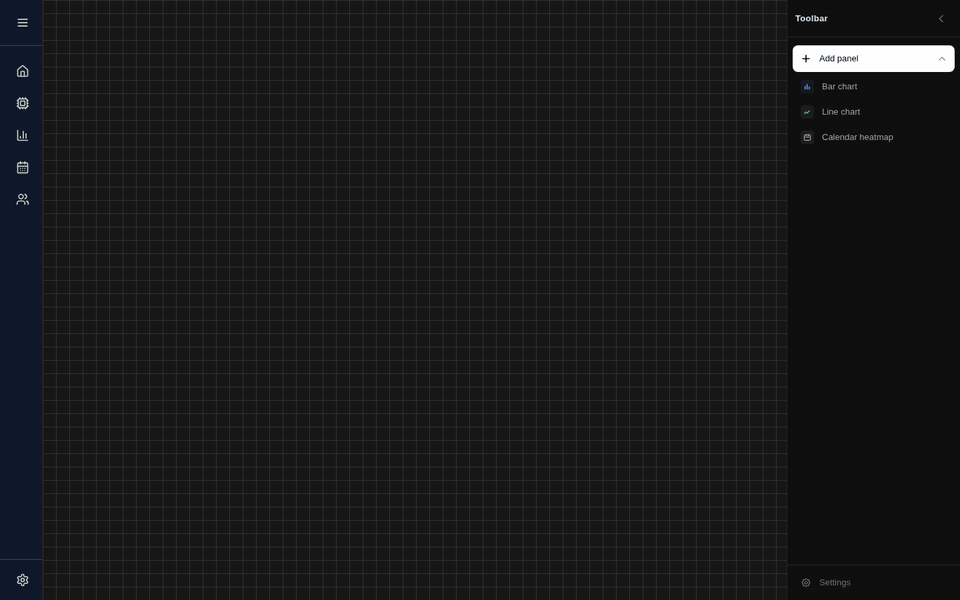
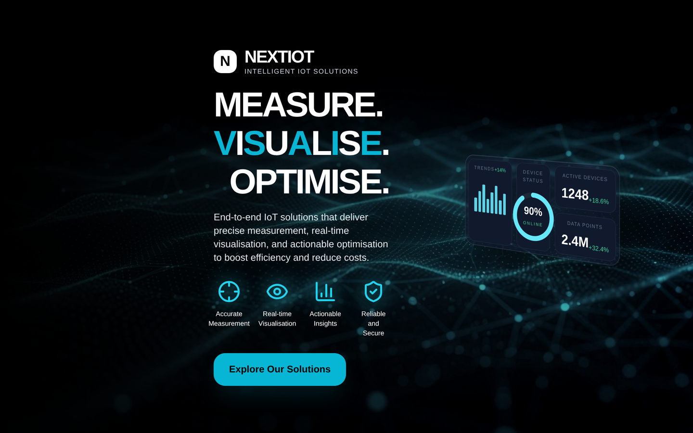
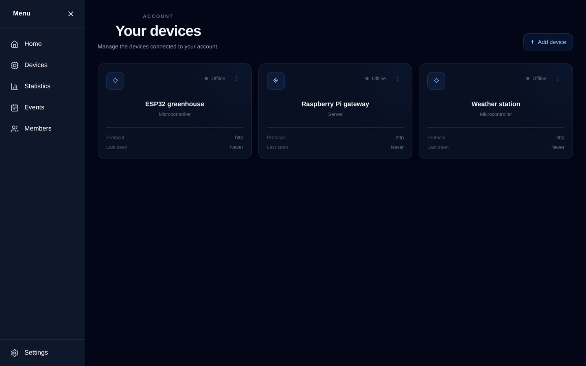
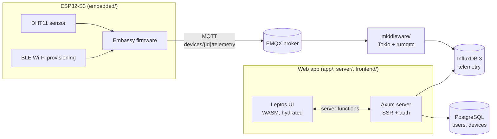

# rustiot

A full-stack IoT platform written in Rust, end to end: firmware on an ESP32-S3, an MQTT ingestion
service, and a Leptos web app where users register devices and build dashboards of live sensor data.

> **Status:** work in progress. Accounts, device management, telemetry ingestion and charts work.
> Saving dashboard layouts is next (see [Roadmap](#roadmap)).



| Landing page | Devices |
|---|---|
|  |  |

## Architecture



| Crate | What it does |
|---|---|
| `embedded/` | `no_std` async firmware for the ESP32-S3 (esp-hal, Embassy). Reads a DHT11, gets Wi-Fi credentials over BLE (GATT), publishes telemetry over MQTT. Built separately with its own toolchain. |
| `middleware/` | Subscribes to `devices/+/telemetry`, parses and validates messages, and writes them to InfluxDB 3. |
| `server/` | Axum binary: server-side rendering, server-function endpoints, JWT cookie auth middleware and protected routes. |
| `app/` | Leptos components and server functions shared by server and browser: login/sign-up, device CRUD, drag-and-resize dashboard grid, ECharts wrappers. |
| `frontend/` | The WASM entry point that hydrates `app` in the browser. |
| `shared/` | Types used across crates: DTOs, JWT helpers, database domain types. |

## Highlights

- **One language from sensor to screen.** The firmware, ingestion service, backend and UI are all Rust.
- **Type-checked SQL.** Queries use `sqlx` macros checked against the schema at compile time
  (offline data in `.sqlx/`, so the project builds without a database).
- **Auth.** Argon2 password hashing, signed JWTs in HTTP-only cookies, device records scoped to their owner.
- **Device onboarding over BLE.** The device exposes a GATT service for Wi-Fi SSID and password, then connects and starts publishing.
- **Dashboard grid.** Panels snap to a grid, can be dragged and resized, and are placed in the nearest free spot automatically.

## Running locally

Requirements: Rust nightly (pinned in `rust-toolchain.toml`), `wasm32-unknown-unknown` target,
[`cargo-leptos`](https://github.com/leptos-rs/cargo-leptos), [`sqlx-cli`](https://crates.io/crates/sqlx-cli), Docker.

**1. Postgres**

```bash
docker run -d --name rustiot-postgres -p 5432:5432 \
  -e POSTGRES_USER=leptos -e POSTGRES_PASSWORD=leptos -e POSTGRES_DB=leptos postgres:16
cp .env.example .env               # then set JWT_SECRET
sqlx migrate run --source server/migrations
```

**2. Broker, InfluxDB and middleware**

```bash
cd middleware
cp .env.example .env
docker compose up -d --build       # EMQX on :1883 (dashboard :18083), InfluxDB on :8181
docker exec dc_influxdb cat /var/lib/influxdb3/influx-token.json   # copy "token" into INFLUX_TOKEN in ../.env
```

**3. Web app**

```bash
cargo leptos watch                 # http://127.0.0.1:3000
```

**Send test telemetry without hardware**

```bash
mosquitto_pub -h localhost -t devices/test-device/telemetry -m '{"data": {"temp": 22.5, "hum": 41}}'
```

**4. Firmware (optional)**

Needs the Xtensa toolchain (`espup install`) and `espflash`. Set `BROKER_HOST` in
`embedded/src/tasks/mqtt.rs` to the machine running EMQX, then:

```bash
cd embedded
cargo run --release                # flashes and opens the serial monitor
```

Provision Wi-Fi by writing the SSID and password to the `WiFi Provision` BLE service (any BLE app such as nRF Connect works).

## Roadmap

- [ ] Save and load dashboard panels per user (the `dashboards` and `panels` tables exist; the UI still uses sample panels)
- [ ] Bind panels to live device telemetry
- [ ] Link registered devices to their MQTT ids and check ownership when reading telemetry (reads currently require login, but not ownership)
- [ ] Broker address and credentials via provisioning instead of a constant in the firmware
- [ ] MQTT over TLS
- [ ] Tests for the middleware parsers and server functions

## License

Public domain under [The Unlicense](LICENSE).
